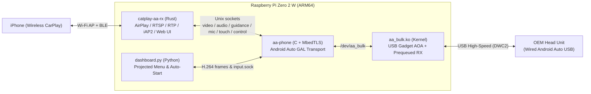

# CarFluxoid

**Wireless Apple CarPlay over Wired Android Auto — built for Raspberry Pi Zero 2 W.**

CarFluxoid turns a Raspberry Pi Zero 2 W into an autonomous in-car adapter that speaks **wired Android Auto (AOA/GAL)** to your car’s OEM head unit over USB while hosting a **wireless Apple CarPlay** receiver over Wi-Fi + Bluetooth for your iPhone.

Validated on real vehicle hardware (**Fiat Tipo / Uconnect VP2**, 800×480, Continental AG VP2) as well as Google Desktop Head Unit (DHU).

---

## Features

| Area | Capability |
| :--- | :--- |
| **Video** | H.264 passthrough with zero-reencode POC type-2 rewriting (`h264_poc.h`), automatic display resolution & OEM safe-area margin negotiation (`800×480`, `1280×720`, `1920×1080`), 1–3 ms USB ACK latency |
| **Audio** | 48 kHz stereo PCM media sink with adaptive pre-roll, RTP reorder recovery, audio-focus state machine, plus dedicated **16 kHz mono guidance channel** (`AltAudio` / Waze / Siri prompts) |
| **Microphone & Calls** | Native car microphone capture (`ch=3`) forwarded to CarPlay for Siri and phone calls (`VoiceSessionNotification`), with clean media ducking/resume |
| **Vehicle Sensors & GPS** | Subscribes to Android Auto `SensorSourceService` (`ch=7`): **auto Day/Night theme** from car headlights, plus **1 Hz car GPS & vehicle speed** relayed to iPhone via iAP2 NMEA (`$GPGGA`, `$GPRMC`, `$PASCD`) |
| **Steering-Wheel & Rotary Controls** | Unpacked proto2 key bindings (`Back`, `Play/Pause`, `Next/Prev`, `VR/Siri`, `Call/Hangup`, rotary scroll wheel) mapped to CarPlay HID & Siri commands |
| **Metadata & Bluetooth** | Relays iAP2 `NowPlaying` track metadata to AA `MediaPlaybackStatus` (`ch=11`) and forwards the head unit’s Bluetooth MAC (`ch=9`) to CarPlay (`bluetoothIDs`) |
| **Projected Dashboard & Auto-Start** | On-screen touchscreen menu rendered directly over Android Auto, with **automatic CarPlay startup** (2 s settle window, cancelled on touch) |
| **Web UI, Diagnostics & OTA** | Local web portal at `http://192.168.50.2` for settings, custom OEM CarPlay icon upload, live JSON status (`/diag`), boot/vehicle log viewer (`/logs`), and signed tarball **OTA updates** (`/ota`) |

---

## Architecture



See [docs/ARCHITECTURE.md](docs/ARCHITECTURE.md) for the full channel map, IPC socket layout, and systemd service topology.

---

## Repository Layout

```text
assets/                  Logo, test frame, and pre-aligned waiting screens (480p/720p/1080p)
bridge-aa/
  carplay-rx/            Rust wireless CarPlay receiver, iAP2 GPS/NowPlaying hub, and HTTP web/OTA server
  kernel/                Out-of-tree Linux USB gadget driver (aa_bulk.ko)
  src/                   C Android Auto phone-side transport (aa_phone.c, h264_poc.h, mtp.h)
  tests/                 Native C protocol tests and Python HTTP/MTP runtime tests
catplay/                 Pinned upstream CatPlay submodule (patched via patches/catplay.patch)
docs/                    Architecture and installation guides
patches/                 Clean patch applied on top of catplay/
platforms/raspberrypi/   ARM64 Dockerfile, build/test scripts, systemd units, installers, dashboard
scripts/                 Submodule patcher, TLS fetcher, waiting screen encoder
tests/                   Host Python unit tests (projected dashboard)
tooling/                 Pinned MbedTLS manifest and H.264 SPS/PPS alignment tool
```

---

## Quick Start

### 1. Hardware Requirements

- **Raspberry Pi Zero 2 W** + microSD card flashed with **Raspberry Pi OS Lite (64-bit)**
- Short, good-quality **micro-USB data cable** plugged into the Pi’s **USB** port (closest to mini-HDMI; `PWR IN` is power-only)
- Owner-supplied MFi identity (`certificate.p7b` and `identity.pk8`) for wireless CarPlay authentication (never committed to git)

### 2. Build ARM64 Binaries & OTA Bundle

Requires Docker with `linux/arm64` support (native on Apple Silicon / ARM64 Linux, or QEMU binfmt on x86_64):

```sh
make prepare   # init catplay submodule & apply patches/catplay.patch
make image     # build self-contained ARM64 build image
make build     # compile aa-phone + catplay-aa-rx and create local/raspberrypi/carfluxoid-update.tar.gz
make test      # run Rust, C, HTTP, MTP, and dashboard test suites
```

### 3. First-Time Pi Installation

See the step-by-step guide in [docs/INSTALL.md](docs/INSTALL.md) (building `aa_bulk.ko` against the Pi’s running kernel, running `install-base.sh`, `prepare-radio.sh`, and `install-dashboard.sh`).

### 4. Subsequent Updates (SSH or Web OTA)

Once CarFluxoid’s Wi-Fi AP has been activated (`CarFluxoid-Pi_AP`), the Pi stays on **`192.168.50.2`** and does not automatically return to your home Wi-Fi. Connect your laptop or phone to **`CarFluxoid-Pi_AP`**, then:

- **Over SSH**:
  ```sh
  make deploy
  ```
- **Over the Web UI (OTA)**: open `http://192.168.50.2`, go to **Mise à jour (OTA)**, and upload `local/raspberrypi/carfluxoid-update.tar.gz`.

*(To temporarily switch the Pi back to a saved home Wi-Fi network, run `sudo /opt/carfluxoid/bin/return-home.sh <HOME_UUID>` over SSH.)*

### 5. Vehicle Diagnostics

CarFluxoid persists bounded snapshots (`dmesg`, `aa_bulk` counters, `systemd` journals, and `/run/carfluxoid/session.log`) to `/var/lib/carfluxoid/car-diag.log` (rotated to `car-diag.prev.log` on the next boot):

```sh
make logs HOST=aymene@192.168.50.2
```

Or view them directly from your phone/browser at `http://192.168.50.2/diag` and `http://192.168.50.2/logs?which=prev`.

---

## License

GPL-3.0-or-later (see [LICENSE](LICENSE)); kernel module `aa_bulk.c` is GPL-2.0.
