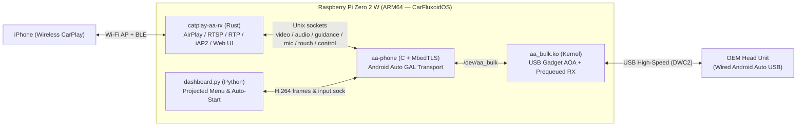

# CarFluxoid

**Wireless Apple CarPlay over Wired Android Auto — powered by CarFluxoidOS on Raspberry Pi Zero 2 W.**

CarFluxoid turns a **Raspberry Pi Zero 2 W** into a fast-booting (~5 s), power-cut-proof in-car adapter that speaks **wired Android Auto (AOA/GAL)** to your car’s OEM head unit over USB while hosting a **wireless Apple CarPlay** receiver over Wi-Fi + Bluetooth for your iPhone.

Validated on real vehicle hardware (**Fiat Tipo / Uconnect VP2**, 800×480, Continental AG VP2) as well as Google Desktop Head Unit (DHU).

---

## Features

| Area | Capability |
| :--- | :--- |
| **CarFluxoidOS** | Purpose-built Buildroot ARM64 appliance OS (~53 MiB read-only ZSTD SquashFS), **4 s USB / 5 s Wi-Fi boot**, power-cut-proof, atomic **A/B OS updates** with persistent `/data` |
| **Video** | H.264 passthrough with zero-reencode POC type-2 rewriting (`h264_poc.h`), automatic display resolution & OEM safe-area margin negotiation (`800×480`, `1280×720`, `1920×1080`), 1–3 ms USB ACK latency |
| **Audio** | 48 kHz stereo PCM media sink with adaptive pre-roll, RTP reorder recovery, audio-focus state machine, plus dedicated **16 kHz mono guidance channel** (`AltAudio` / Waze / Siri prompts) |
| **Microphone & Calls** | Native car microphone capture (`ch=3`) forwarded to CarPlay for Siri and phone calls (`VoiceSessionNotification`), with clean media ducking/resume |
| **Vehicle Sensors & GPS** | Subscribes to Android Auto `SensorSourceService` (`ch=7`): **auto Day/Night theme** from car headlights, plus **1 Hz car GPS & vehicle speed** relayed to iPhone via iAP2 NMEA (`$GPGGA`, `$GPRMC`, `$PASCD`) |
| **Steering-Wheel & Rotary Controls** | Unpacked proto2 key bindings (`Back`, `Play/Pause`, `Next/Prev`, `VR/Siri`, `Call/Hangup`, rotary scroll wheel) mapped to CarPlay HID & Siri commands |
| **Metadata & Bluetooth** | Relays iAP2 `NowPlaying` track metadata to AA `MediaPlaybackStatus` (`ch=11`) and forwards the head unit’s Bluetooth MAC (`ch=9`) to CarPlay (`bluetoothIDs`) |
| **Projected Dashboard & Auto-Start** | On-screen touchscreen menu rendered directly over Android Auto, with **automatic CarPlay startup** (2 s settle window, cancelled on touch) |
| **Web UI, Diagnostics & OTA** | Local web portal at `http://192.168.50.2` for settings, custom OEM CarPlay icon upload, live JSON status (`/diag`), boot/vehicle log viewer (`/logs`), and signed tarball **OTA updates** (`/ota`) |

---

## Quick Install — CarFluxoidOS (Raspberry Pi Imager)

### 1. What You Need
- **Raspberry Pi Zero 2 W** + microSD card (2 GB or larger)
- Short, good-quality **micro-USB data cable** plugged into the Pi’s **USB** port (closest to mini-HDMI — `PWR IN` is power-only)
- **iAP2 / MFi authentication certificates** (`certificate.p7b` and `identity.pk8`), required by Apple CarPlay — not bundled in the OS image for licensing reasons. You can obtain them from [Roylyl/MacPlay — `assets/authentication`](https://github.com/Roylyl/MacPlay/tree/main/assets/authentication) (or supply your own).

### 2. Flash the SD Card
1. Download **`carfluxoid-os.img.xz`** from the latest [GitHub Release](https://github.com/aymene69/CarFluxoid/releases/latest).
2. Open **[Raspberry Pi Imager](https://www.raspberrypi.com/software/)**:
   - **Device**: Raspberry Pi Zero 2 W
   - **Operating System**: scroll to the bottom → **Use custom** → select `carfluxoid-os.img.xz`
   - **Storage**: select your microSD card
   - When asked *"Would you like to apply OS customisation settings?"*, click **No** (CarFluxoidOS is preconfigured).
3. Wait for the flash & verification to finish.

### 3. Add Your iAP2 Authentication Certificates
Re-insert the microSD card on your Mac/PC so the FAT32 partition **`CARFLUXBOOT`** mounts, then copy these two files to the root of **`CARFLUXBOOT`**:
- `certificate.p7b`
- `identity.pk8`

*(Optional: you can also drop `wifi-pass.txt` with an 8–63 character passphrase to override the default Wi-Fi password, or `authorized_keys` for passwordless SSH.)*

On first boot, CarFluxoidOS automatically moves `certificate.p7b` and `identity.pk8` into the persistent `/data/identity/` partition (`chmod 600`) and deletes the copies from `CARFLUXBOOT`.

### 4. Plug In & Drive
1. Eject the microSD card and insert it into the Raspberry Pi Zero 2 W.
2. Plug your micro-USB data cable from the car’s Android Auto USB port into the Pi’s **USB** (DATA) port.
3. Wait ~5 seconds: Android Auto launches automatically on the head unit.
4. On your iPhone, pair Bluetooth with **`CarFluxoid`** and accept CarPlay.
5. To customize settings, upload a custom car logo, view live logs, or apply OTA updates, join Wi-Fi **`CarFluxoid-Pi_AP`** (default password **`c@rfluxoid`**) and open **`http://192.168.50.2`** (or `http://carfluxoid.local`).
   - SSH access: `ssh root@192.168.50.2` (default password **`c@rfluxoid`**).

*(Prefer running on standard Raspberry Pi OS Lite 64-bit instead? See [docs/INSTALL.md](docs/INSTALL.md).)*

---

## Updating Without Losing Data (A/B + OverlayFS)

CarFluxoidOS separates the read-only OS (**Slot A** `mmcblk0p2` and **Slot B** `mmcblk0p3`) from your persistent **`/data`** partition (`mmcblk0p4`: iAP2 certificates, iPhone HomeKit pairings, Bluetooth pairings, Wi-Fi password, SSH host keys, and all Web UI settings). **You never need to reflash your SD card or re-copy certificates after the initial flash.**

Connect your Mac/PC or phone to Wi-Fi **`CarFluxoid-Pi_AP`** (`192.168.50.2`, password `c@rfluxoid`):

- **Full OS update (atomic A/B — kernel, DTB, config, rootfs; `/data` untouched)**:
  Download `carfluxoid-os-update.tar` from the latest Release (or build it with `make os`) and run:
  ```sh
  ssh root@192.168.50.2 /usr/sbin/carfluxoid-os-update < carfluxoid-os-update.tar
  # or from a repo checkout:
  make os-update
  ```
  The updater verifies `SHA256SUMS`, flashes the **inactive** A/B partition, reads it back to verify its SHA256 on flash, switches `cmdline.txt` atomically, and reboots — keeping all certificates, pairings, and settings 100% intact.

- **Fast app-only update (3 s, no reboot; `/data` untouched)**:
  - **Web UI**: open `http://192.168.50.2` → **Mise à jour (OTA)** → upload `carfluxoid-update.tar.gz`.
  - **SSH**: `make deploy`

- **Backup / Restore `/data`** (certificates, pairings, settings):
  ```sh
  make backup    # saves local/os/data-backup.tar.gz (gitignored)
  make restore   # restores local/os/data-backup.tar.gz onto /data and reboots
  ```

---

## Architecture



See [docs/ARCHITECTURE.md](docs/ARCHITECTURE.md) and [os/README.md](os/README.md) for full details.

---

## Build from Source

Requires Docker with `linux/arm64` support (native on Apple Silicon / ARM64 Linux, or QEMU binfmt on x86_64):

```sh
make prepare    # init catplay submodule & apply patches/catplay.patch
make image      # build self-contained ARM64 build image
make build      # compile aa-phone + catplay-aa-rx -> local/raspberrypi/carfluxoid-update.tar.gz
make test       # run Rust, C, HTTP, MTP, and dashboard test suites
make tls        # download & verify reference Android Auto TLS cert/key
make os-image   # build CarFluxoidOS Buildroot Docker image
make os         # build local/os/carfluxoid-os.img.xz + local/os/carfluxoid-os-update.tar
```

### Vehicle Diagnostics

CarFluxoid persists bounded snapshots (`dmesg`, `aa_bulk` counters, service logs, and `/run/carfluxoid/session.log`) to `/var/lib/carfluxoid/car-diag.log` (rotated to `car-diag.prev.log` on the next boot):

```sh
make logs
```

Or view them directly at `http://192.168.50.2/diag` and `http://192.168.50.2/logs?which=prev`.

---

## License

GPL-3.0-or-later (see [LICENSE](LICENSE)); kernel module `aa_bulk.c` is GPL-2.0.
