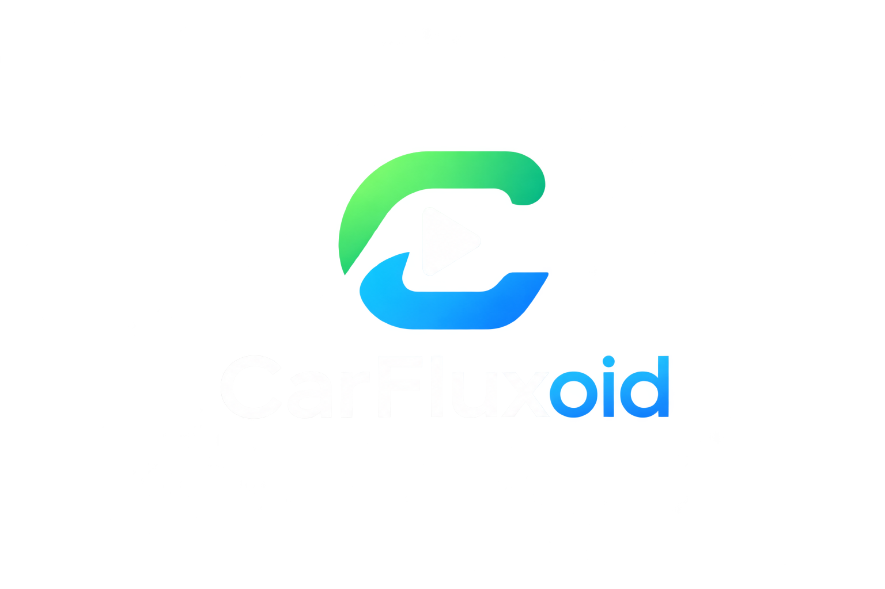
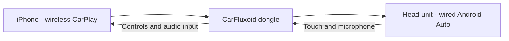
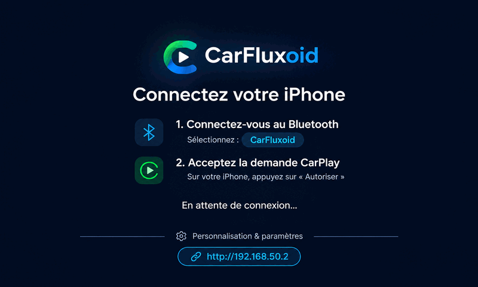

<p align="center">
  
</p>

<h1 align="center">CarFluxoid</h1>
<p align="center"><strong>Wireless CarPlay → wired Android Auto</strong><br>A bridge for compatible Allwinner V821 USB dongles.</p>

<p align="center">
  <a href="https://github.com/aymene69/CarFluxoid/actions/workflows/checks.yml"></a>
  <a href="LICENSE"></a>
  
</p>

CarFluxoid receives wireless CarPlay from an iPhone and forwards its video, audio and controls through a wired Android Auto connection. The receiver and bridge run on the dongle; a computer is used for building, installation and development testing.



## Features

- Wireless CarPlay reception with native H.264 forwarding.
- Music playback and touchscreen control over Android Auto.
- Microphone return implementation for CarPlay voice input.
- Automatic pairing recovery and a waiting screen between phone sessions.
- Local web settings for interface scale, frame rate, resolution selection, appearance and the OEM return button.
- A Docker build environment with pinned sources, per-device firmware composition, backups and verified readback.



## Hardware compatibility

The current profile targets the following combination:

| Component | Supported profile |
|---|---|
| SoC | Allwinner V821, tested non-B revision |
| Radio | RTL8733BS |
| Storage | 16 MiB SPI NOR |
| Firmware base | CatPlay issue 56, pinned **hstimer-off** beta |
| Development receiver | Google Desktop Head Unit |

Retail names do not reliably identify the PCB. X1600, V851 and AIC8800 variants are **not** interchangeable with this profile. Verify the hardware before installation. FEL checks the SoC revision and flash geometry; the radio must be confirmed separately.

## Getting started

Read the **[installation and recovery guide](docs/INSTALL.md)** before connecting a device for flashing. It covers host dependencies, factory-firmware bootstrap, backups, image composition and restoration.

To build the project on a supported Linux or macOS host with Docker and Python 3.12+:

```sh
git clone --recurse-submodules https://github.com/aymene69/CarFluxoid.git
cd CarFluxoid
python3 -m venv .venv
.venv/bin/pip install -r requirements.txt
.venv/bin/python carfluxoid.py fetch
.venv/bin/python carfluxoid.py sdk
.venv/bin/python carfluxoid.py build
.venv/bin/python carfluxoid.py test
```

Build outputs are placed in `local/artifacts/`. Flashing is a separate, explicit step using a verified backup of the target dongle. Device identities, keys, backups and composed images remain local and are excluded from Git.

## Using CarFluxoid

Connect the installed dongle to the Android Auto receiver, pair the iPhone with **CarFluxoid**, and accept CarPlay on the phone. To configure the bridge, connect to the dongle’s Wi-Fi and open **http://192.168.50.2**.

| Setting | What it changes |
|---|---|
| Interface scale | Physical display dimensions announced to iOS; pixel resolution and touch coordinates stay unchanged |
| Maximum resolution | Selects an available Android Auto format: 800×480, 1280×720 or 1920×1080 |
| Frame rate | Requests a maximum of 10, 15, 20 or 30 fps from the iPhone |
| Touch mode | Announces assisted or direct touch; touchscreen input remains enabled |
| Return app | Name, logo and visibility of the app used to return to the head unit |
| Appearance | Sidebar side and day/night preference |

Reconnect CarPlay after changing its display settings. A resolution change requires restarting the dongle. iOS determines the final layout; the scale percentages are indicative. H.264 bitrate control is not implemented.

### Why does DHU reject 400×240?

The supported landscape video resolutions documented for DHU are **800×480**, **1280×720** and **1920×1080**. Setting `resolution = 400x240` in its INI file causes DHU to fall back to 800×480. Interface scale is a separate CarPlay setting, not a custom Android Auto video resolution.

A head unit negotiates its own available formats. The bridge selects from those formats; DHU's fallback message neither proves nor rules out compatibility with a particular Uconnect unit. See [Google's DHU configuration reference](https://developer.android.com/training/cars/testing/dhu).

## Project status

CarFluxoid is a **development preview**. The following distinctions reflect the current validation record:

| Area | Status |
|---|---|
| Video, music and touch | Exercised on the development dongle with Google DHU |
| Clean SDK and firmware build | Rebuilt from pinned inputs in a new environment |
| USB module | Rebuilt executable code matches the hardware-tested reference |
| Image tools | Offline backup/composition/write/readback tests and CI checks pass |
| Microphone / Siri | Implemented; hardware validation still required |
| Factory-to-CarFluxoid installation | Implemented; full acceptance test on a second factory device pending |
| Uconnect | Not yet validated end-to-end |
| LIVI | Not a validated receiver for this bridge |

The bridge reuses the pinned CatPlay kernel, vendor initialization and radio blobs. It does not claim to rebuild every proprietary firmware component. The local reference Android Auto TLS identity also has receiver-specific acceptance and an expiry date; details are in the installation guide.

## Documentation

- **[Install and recover](docs/INSTALL.md)** — complete device workflow.
- **[Build internals](docs/BUILD.md)** — SDK, locked inputs, artifacts and tests.
- **[Display settings](docs/DISPLAY.md)** — resolution, scale and frame rate.
- **[Validation record](docs/VALIDATION.md)** — completed checks and hardware limits.
- **[Reproducibility scope](docs/REPRODUCIBILITY.md)** — included and external components.

The code is organized under `bridge-aa/`, the image/device tooling under `tooling/`, and the upstream CatPlay changes in `patches/catplay.patch`. Waiting-screen PNGs and H.264 assets are in `assets/waiting/`; regenerate them with `python3 scripts/encode-waiting-screens.py` using Pillow and FFmpeg.

## Contributing

Include the hardware revision, receiver model, source commit and sanitized logs when reporting a problem. Keep firmware backups, pairing databases, Wi-Fi credentials and private keys out of issues and commits. Source checks run automatically; the full build workflow can be dispatched separately without performing hardware writes.

## License and acknowledgments

The bridge is distributed under **[GPL-3.0](LICENSE)**. Dependencies retain their own licenses and notices.

CarFluxoid builds on [CatPlay](https://github.com/catplay-labs/catplay), with additional protocol and tooling references credited in the build scripts and documentation. CatPlay is pinned as a submodule, and local changes are maintained as a separate patch.
